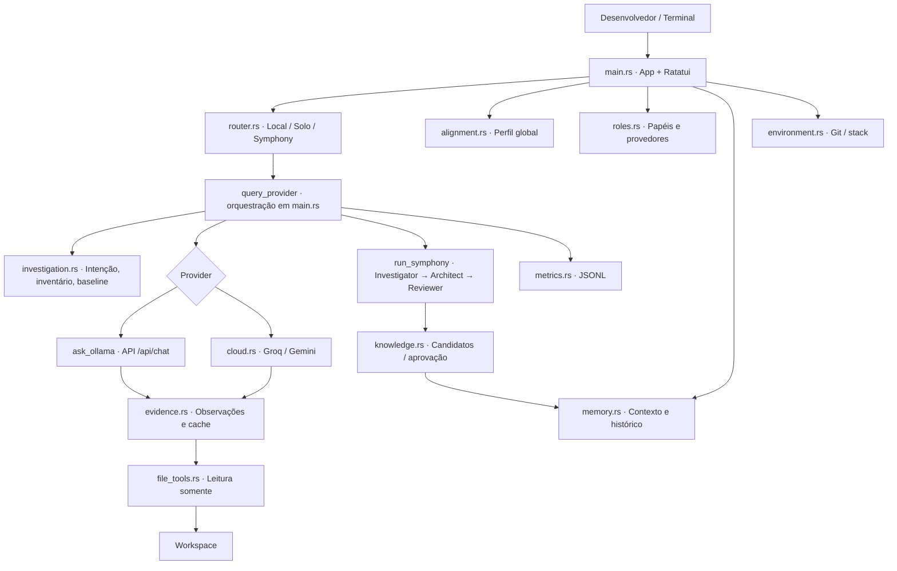
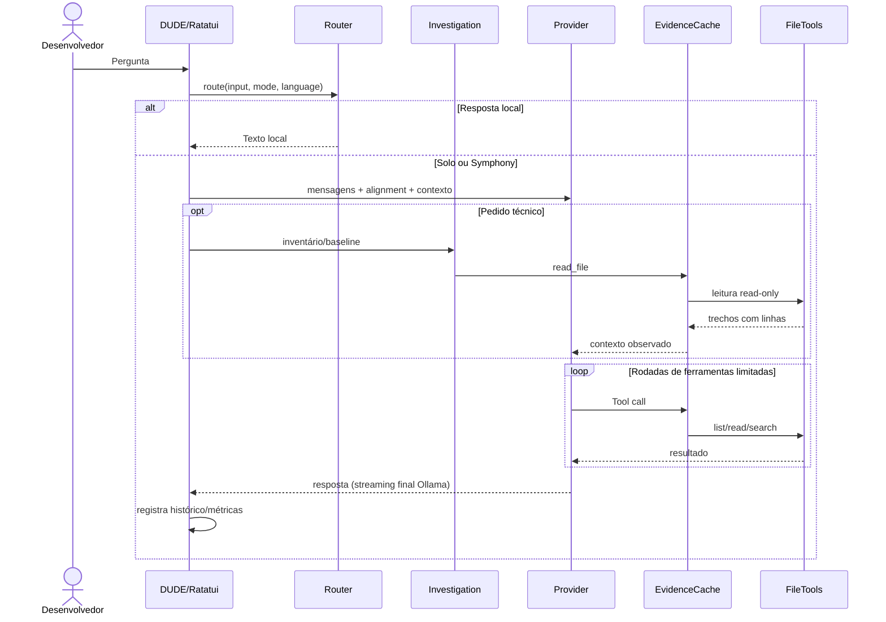
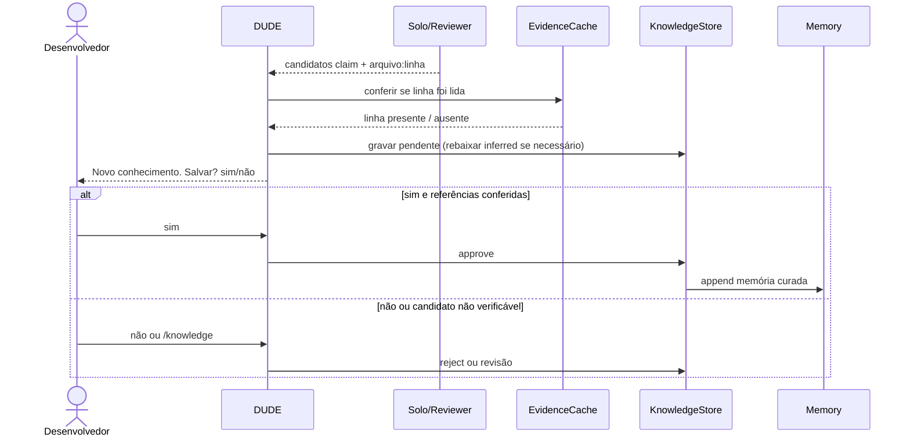
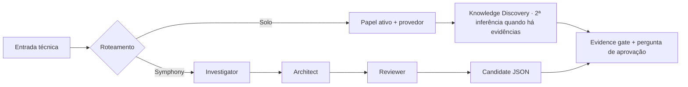
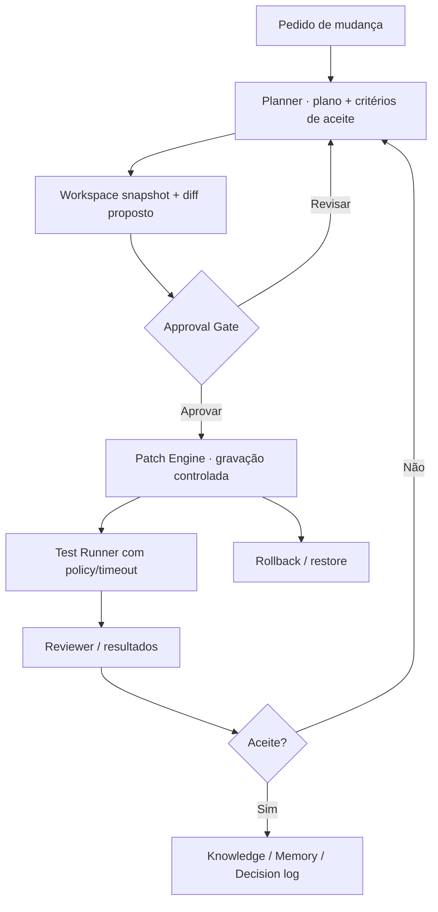

# DUDE — Arquitetura, componentes e fluxos

Estado observado na main em 2026-10-20. Diagramas diferenciam **runtime atual** e **arquitetura-alvo**.

## 1. Componentes atuais



`main.rs` acumula responsabilidades de UI, comandos, orquestração e provider. Esta é a topologia **atual**, não um conjunto de crates/microserviços isolados.

### Tabela de propriedade e confiança

| Componente | Responsabilidade | Limitação atual |
|---|---|---|
| Ratatui + main.rs | estado UI, prompt, comandos, canal async e streaming | runtime monolítico |
| router.rs | roteamento de intenção local/Solo/Symphony | heurístico |
| roles.rs | mapping papel → provedor + modo persistido | OpenAI anunciado sem adapter |
| investigation.rs | política de investigação, baseline e inventário | amostra limitada; sem cobertura semântica |
| evidence.rs | leitura rastreada, cache e referência `arquivo:linha` observada | presença de linha ≠ sustentação lógica |
| file_tools.rs | listagem, busca textual e leitura limitadas | read-only; não é sandbox integral |
| cloud.rs / ask_ollama | inferência externa/local e tool-calling | timeout/retry diferentes entre provedores |
| knowledge.rs | candidatos, revisão e promoção | sem resolução semântica/conflitos |
| memory.rs | histórico, decisões e memória curada | sem store por tarefa estruturado |
| alignment.rs | idioma, detalhe e ritmo globais | nem todas as mensagens locais traduzidas |
| metrics.rs | estágio/tokens/tool events | métricas não equivalem a testes de qualidade |

## 2. Fluxo — conversa e investigação (atual)



A API Ollama é usada remotamente com `OLLAMA_HOST` se configurada. O Linux executa o DUDE e acessa arquivos do Linux; o Mac executa apenas o servidor de inferência. Groq/Gemini exigem consentimento cloud.

## 3. Fluxo — Knowledge com pergunta ao desenvolvedor (atual)



`EvidenceCache.observed_reference` confirma **observação literal** de linha em saída de `read_file`. Não verifica significado da afirmação, nem se o conteúdo do arquivo mudou depois da leitura. Evitar chamar isso de validação semântica.

## 4. Fluxo — Solo vs Symphony



Nota: a fase de Knowledge Solo acrescenta uma chamada ao modelo quando houve coleta de evidências, podendo aumentar a latência e custo.

## 5. Persistência e limites

```text
workspace/
  .dude/
    roles.json
    context.md
    decisions.md
    memory.md
    history.jsonl
    checkpoints.md          (sob demanda)
    knowledge_candidates.json
    metrics.jsonl

~/.config/dude/
  communication.json         (alinhamento global)
  gemini.key / groq.key      (credenciais locais, quando usadas)
```

A leitura por ferramenta rejeita caminhos absolutos, regiões sensíveis e caminhos que escapam do workspace após canonicalização. Ferramentas não modificam arquivos. O comando iniciado por `!` executa o programa fornecido pelo usuário no sistema com seus privilégios; não caracteriza execução segura arbitrária pelo agente.

## 6. Arquitetura-alvo — Engineering Execution Engine (AINDA NÃO IMPLEMENTADO)



O Approval Gate deve ser um componente verificável do runtime e preservar plano, diff, hash/baseline e decisão do usuário. `!command` não substitui esse mecanismo.

## 7. Evolução arquitetural recomendada

Extrair gradualmente o motor de provedores de `main.rs` para interfaces/estruturas de contexto; separar `ExecutionSession`, `EvidenceLedger`, `KnowledgeReview` e `PatchProposal`, mantendo o CLI/TUI como um adaptador. Isso reduz a dependência de dezenas de parâmetros em `query_provider`, `run_symphony` e `ask_ollama`. São **propostas de design**, não módulos existentes.

## 8. Decisões e riscos

- **DL-001**: runtime nativo Rust no computador de trabalho; inferência via Ollama remoto opcional.
- **DL-002**: Solo default para minimizar custo e latência; Symphony por escolha/complexidade.
- **DL-003**: ferramentas de IA atuais somente leitura; mutação supervisionada apenas após aprovação.
- **DL-004**: Knowledge proposto automaticamente, promovido manualmente.
- **DL-005**: evidência de leitura vs verificação lógica são categorias diferentes.
- **DL-006**: GitHub Actions desligadas por escolha do usuário; validação local, não presumir CI verde.
- **Riscos abertos**: Ollama remoto indisponível, resposta parcial em streaming seguida de erro, Knowledge com referências textualmente válidas mas semanticamente frágeis, leitura truncada, comandos `!` arbitrários do usuário, ausência de rollback do executor futuro.
