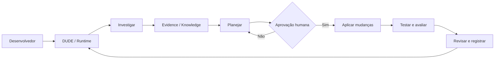
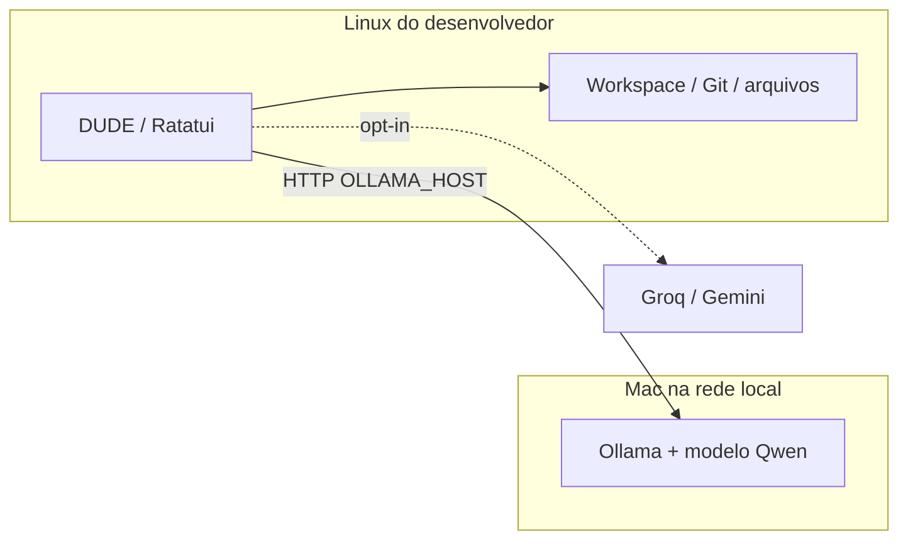

# DUDE — Visão e princípios de AI Co-Engineering

Status: visão de produto e arquitetura-alvo. Não confundir com funcionalidades implementadas.

## Objetivo que definimos

O DUDE (Demented Unified Development Entity) deve deixar de ser somente um chatbot com acesso a arquivos e tornar-se um **parceiro de engenharia de software**: capaz de investigar, explicar, planejar, propor alterações, executar ações autorizadas, testar, revisar e aprender sobre cada projeto com evidências auditáveis.

**DUDE é o ambiente de execução; AI Co-Engineering é a metodologia de colaboração que o governa.**

A autonomia é progressiva e supervisionada. O sistema pode explorar e formular hipóteses sem interromper o desenvolvedor, mas alterações no código, execução de operações potencialmente destrutivas e promoção de conhecimento como fato exigem autorização adequada.

## Princípios

1. **Evidência antes de conclusão.** Documentação, código lido, teste executado, hipótese e lacuna são categorias diferentes. A IA não atribui percentuais de cobertura sem cálculo independente.
2. **Autonomia com fronteiras.** Explorar e planejar é distinto de escrever, executar, commitar ou publicar. O mecanismo de autorização precisa fazer parte do runtime, não depender apenas de prompt.
3. **Conhecimento curado.** Descobrir candidatos automaticamente em Solo/Symphony; conferir referências de fonte; pedir autorização para promover à memória. Conferir uma linha não prova a veracidade semântica da conclusão.
4. **Memória contextual.** Separar preferências globais do usuário, contexto do workspace, decisões, histórico conversacional e estado de tarefas. Parte disso já existe; checkpoints de retomada e memória por tarefa estruturada são metas.
5. **Metapadrão de comunicação.** Alignment/LevelUp é uma política transversal reutilizável, não uma personalidade fixa. Idioma, detalhe e ritmo devem reger UI, respostas locais e provedores.
6. **Independência de inferência.** Interface e ferramentas operam no computador do desenvolvedor; a inferência pode rodar no próprio computador, em um Mac na rede via Ollama, ou em provedores remotos aprovados.
7. **Ciclo fechado de engenharia.** Uma tarefa não termina em uma resposta: identificar critérios de aceite, produzir plano, aprovar diff, aplicar, testar, revisar, registrar resultado e possibilidade de rollback.
8. **Honestidade operacional.** Não declarar “testado”, “seguro”, “aplicado” ou “verificado” sem evento auditável correspondente.

## Diagrama — evolução da relação desenvolvedor/agente

As etapas Aplicar mudanças e Testar por iniciativa do agente **ainda são arquitetura-alvo**. Comandos `!program args` existentes não constituem um executor supervisionado: são comandos digitados diretamente pelo usuário.

## Arquitetura de implantação desejada e já parcialmente possível

O DUDE roda no Linux e manipula somente seu workspace local; o Mac serve a inferência. O DUDE **não inicia o daemon Ollama automaticamente**: verifica `/api/tags` e pode baixar o modelo ausente, desde que o servidor esteja acessível. Hoje `OLLAMA_HOST` e `OLLAMA_MODEL` são variáveis de ambiente; seleção persistente do host é futura.

## Critério de sucesso

Um desenvolvedor deve conseguir pedir “entenda este repositório, investigue o defeito, proponha uma solução e aplique após minha revisão” e receber uma sequência de ações observáveis, com diff, testes, resultado e memória curada, sem precisar operar manualmente o processo inteiro — mas também sem conceder ao agente autoridade irrestrita.

Veja [SPEC.md](SPEC.md), [ARCHITECTURE.md](ARCHITECTURE.md) e [ROADMAP.md](ROADMAP.md).
